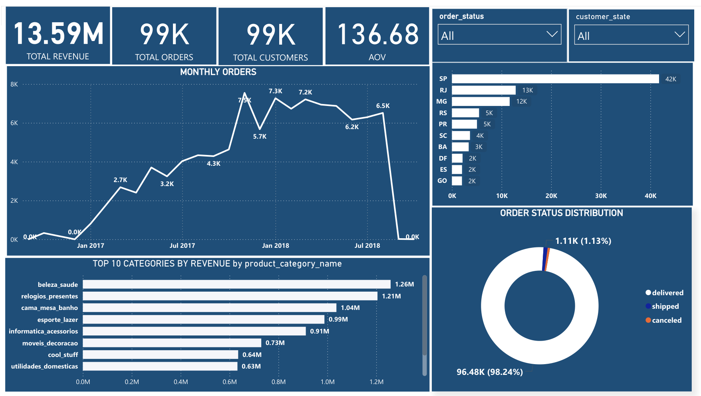

# Brazilian E-Commerce Sales Analysis (Olist Dataset)

## 1. Project Description / Purpose
Analyzed Brazilian e-commerce data using Excel, SQL, and Power BI to understand sales performance, revenue trends, order patterns, and customer behavior.

**Purpose:** To identify sales trends, evaluate business performance, and generate meaningful insights to support data-driven business decisions.

## 2. Tech Stack
- **Excel** – Data exploration, cleaning, and analysis.
- **MySQL** – Data querying and analysis using SQL.
- **Power BI** – Interactive dashboard development and data visualization.

## 3. Data Source
**Brazilian E-Commerce Public Dataset by Olist (Kaggle).**

The dataset contains information about customers, orders, products, sellers, payments, and customer reviews.

## 4. Key Features & Highlights
- Total revenue and order analysis.
- Monthly revenue trends.
- Order status analysis.
- Average Order Value (AOV) calculation.
- Top-performing products by revenue.
- Customer distribution by state.
- Delivery time analysis.
- Freight cost analysis.
- Interactive Power BI dashboard for visualizing key business metrics.

## 5. Project Outcome
Developed an interactive sales dashboard and performed data analysis to understand e-commerce performance, customer distribution, and order trends, supporting better business decisions.

## Project Files
- `Olist_Ecommerce_SQL_Analysis.sql` – SQL queries used for analysis.
- Power BI dashboard (`.pbix`).
- Dashboard screenshot (`.png`).
  
  ## Dashboard Preview

